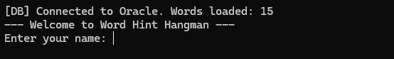
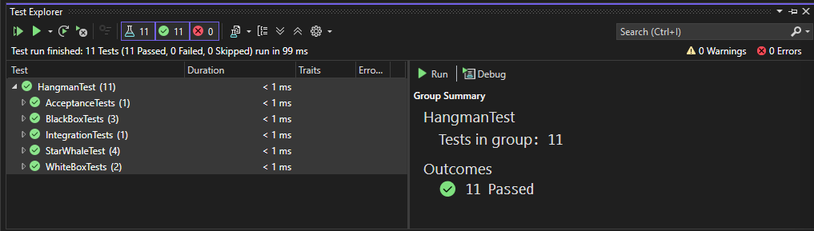

# Word Hint Hangman (C++)

A console word-learning game: the player sees a hint (meaning) and guesses the word.
Words load from an **Oracle database** and fall back to a local file if the DB is unavailable.

## Highlights
- **OOP design**: interface `IWordProvider`, polymorphic skills (`ISkill`), dependency injection into the game class
- **Oracle SQL + OCCI**: reads words and hints from a `HANGMAN_WORDS` table
- **Fallback**: if Oracle fails, the game uses `words.txt`
- **Unit tests**: 11 MSVC CppUnitTest tests using a fake word provider (no DB needed)

## Architecture
```
HangmanApp  (console UI, OracleWordProvider)
   └── HangmanCore  (game logic, FileWordProvider, skills, player)
HangmanTest (unit tests against HangmanCore with a FakeWordProvider)
```
The database code lives only in the app layer, so the core logic and tests stay DB-free.

## Screenshots



## Setup
1. Visual Studio 2022, C++17, **Release x64**
2. Oracle Instant Client 12.2 (OCCI) for the DB mode
3. Copy `StarWhale_Apps/db_config.example.txt` to `db_config.txt` and fill in your own account
   (`db_config.txt` is git-ignored)
4. Create the table and insert words in Oracle:
```sql
CREATE TABLE hangman_words (
  word_id NUMBER PRIMARY KEY,
  word    VARCHAR2(30)  NOT NULL UNIQUE,
  hint    VARCHAR2(200) NOT NULL
);
```
5. Build and run with Ctrl+F5. Without Oracle, the game still runs from `words.txt`.

## Tech
C++17 · Oracle SQL · OCCI · MSVC CppUnitTest · Visual Studio 2022
